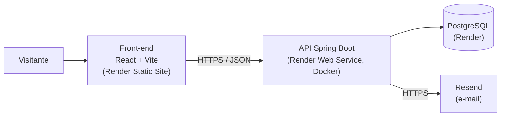
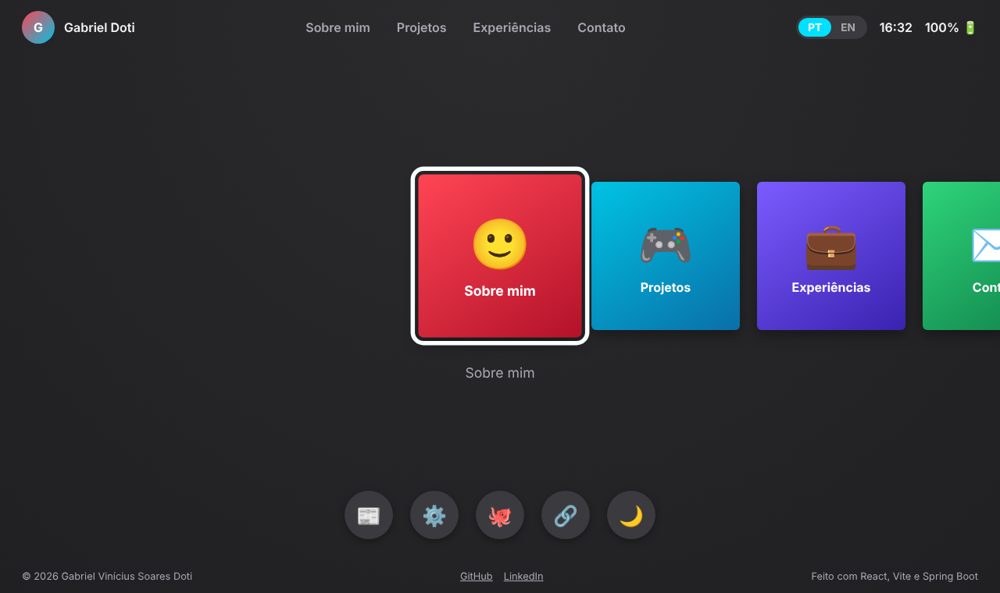
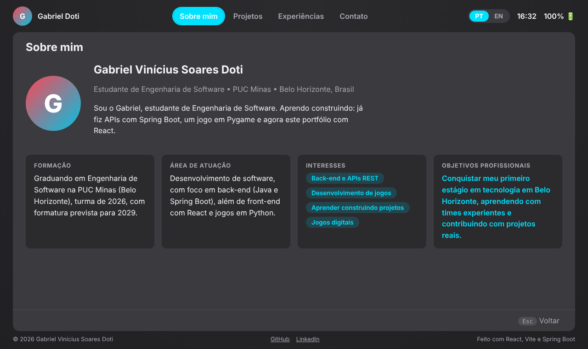
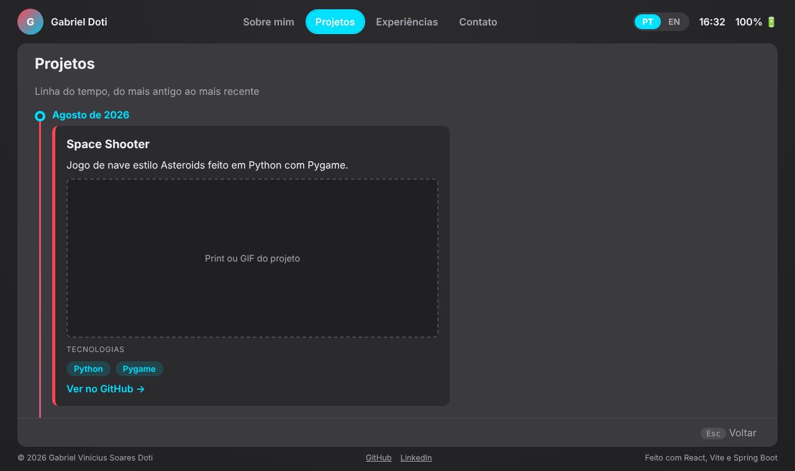
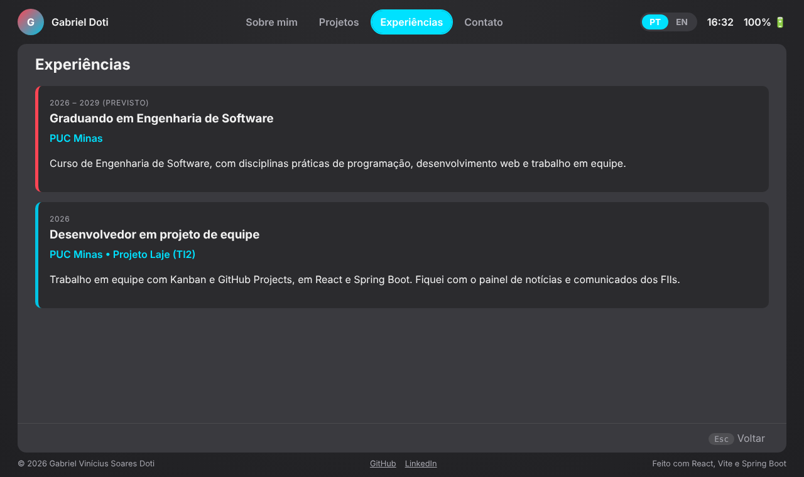
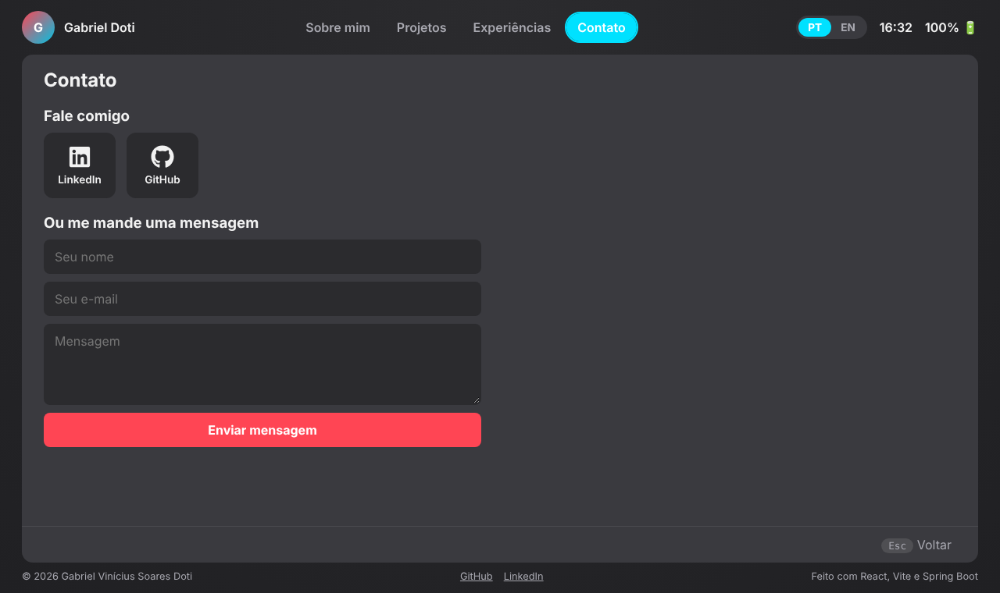
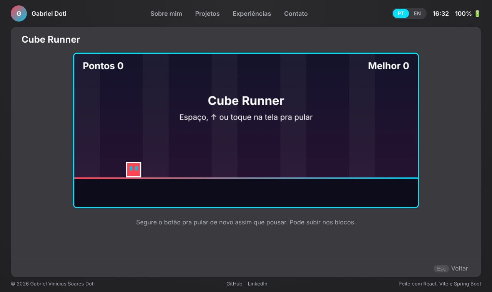
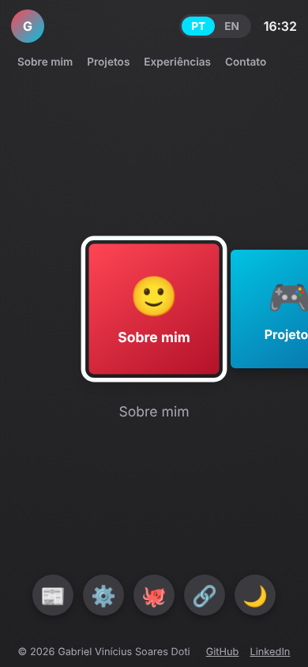
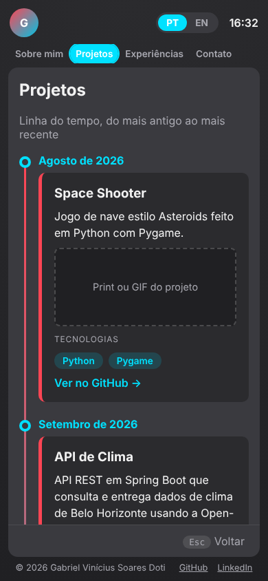
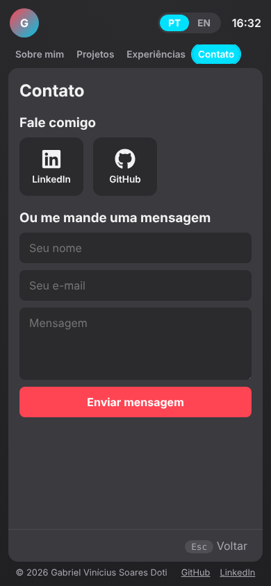

# 🎮 Portfólio Profissional • Gabriel Doti 👨‍💻

Meu portfólio profissional com interface inspirada no menu do Nintendo Switch: apresenta quem eu sou, meus projetos em uma linha do tempo, experiências e formas de contato, tudo em português e inglês.

| | |
|---|---|
| **Laboratório 01 – Portfólio Profissional** | Disciplina DIAW • Engenharia de Software • PUC Minas |
| **Professor** | João Paulo Carneiro Aramuni |
| **Aluno** | Gabriel Vinícius Soares Doti |

## 🚧 Status do Projeto


## 📚 Índice

- [Links Úteis](#-links-úteis)
- [Sobre o Projeto](#-sobre-o-projeto)
- [Requisitos do Laboratório](#-requisitos-do-laboratório)
- [Funcionalidades Principais](#-funcionalidades-principais)
- [Tecnologias Utilizadas](#-tecnologias-utilizadas)
- [Arquitetura](#-arquitetura)
- [Instalação e Execução](#-instalação-e-execução)
- [Deploy](#-deploy)
- [Estrutura de Pastas](#-estrutura-de-pastas)
- [Protótipos e Demonstração](#-protótipos-e-demonstração)
- [Testes](#-testes)
- [Documentações utilizadas](#-documentações-utilizadas)
- [Autores](#-autores)
- [Contribuição](#-contribuição)
- [Agradecimentos](#-agradecimentos)
- [Licença](#-licença)

## 🔗 Links Úteis

| | Link |
|---|---|
| 🌐 **Site publicado** | `https://SEU-SITE.onrender.com` ⚠️ _preencher após o deploy_ |
| 🔌 API (health check) | `https://SUA-API.onrender.com/api/health` ⚠️ _preencher após o deploy_ |
| 💻 Repositório | https://github.com/GabrielDoti/ |

> ℹ️ A API roda no plano gratuito do Render e "dorme" depois de um tempo sem acessos. O primeiro acesso pode levar cerca de 1 minuto; o site mostra os dados locais enquanto ela acorda.

## 📝 Sobre o Projeto

Site de portfólio profissional para apresentar minha trajetória, habilidades, projetos e formas de contato de maneira moderna e acessível. A ideia visual é um "sistema operacional" no estilo do menu do Nintendo Switch: tiles na tela inicial, dock com atalhos e navegação por teclado, mas também com um **menu de navegação convencional no topo** e **rodapé**, para quem prefere o caminho tradicional.

Sou estudante de Engenharia de Software na PUC Minas e busco meu primeiro estágio em tecnologia em Belo Horizonte. Escolhi esse conceito para mostrar, na prática, front-end, back-end e hospedagem na nuvem funcionando juntos.

## ✅ Requisitos do Laboratório

| Requisito do enunciado | Onde está |
|---|---|
| Menu de navegação com as 4 seções | Cabeçalho (`StatusBar.jsx`) e tiles da tela inicial |
| **Sobre Mim** em português e inglês (formação, área, interesses, objetivos) | `apps/About.jsx` + botão **PT / EN** no cabeçalho |
| **Projetos** em linha do tempo, do mais antigo ao mais recente | `apps/Projects.jsx` (ordena pela data) |
| Projeto com nome, descrição, tecnologias, link do GitHub e imagem/GIF | `projects` em `src/data.js` |
| **Experiências** (instituição, cargo, período, descrição) | `apps/Experiences.jsx` |
| **Contato** com ícones clicáveis (e-mail, WhatsApp, LinkedIn, GitHub) | `apps/Contact.jsx` |
| Formulário (nome, e-mail, mensagem) com envio por e-mail | `apps/Contact.jsx` → `POST /api/contato` → `EmailNotifier.java` (Resend) |
| Validações básicas | HTML5 no front + Bean Validation no back |
| Design responsivo e identidade visual coerente | `src/styles.css` (testado em desktop e celular) |
| Hospedagem gratuita na nuvem | Render (`render.yaml`) |
| README completo | Este arquivo |

## ✨ Funcionalidades Principais

- 🌎 Site **bilíngue** (português e inglês), com a escolha lembrada no navegador
- 🧭 Navegação por menu superior, tiles, dock e **teclado** (setas, Enter e Esc)
- 🕑 **Linha do tempo** de projetos ordenada por data
- 💼 Seção de **experiências** e de **skills**
- ✉️ **Formulário de contato** com validação, proteção anti-spam (campo escondido e limite de envios) e aviso por e-mail
- 🎮 Minijogo **Cube Runner** (auto-runner) com recorde salvo no navegador
- 📰 Novidades vindas da API e **contador de visitas**
- 🌗 Tema claro/escuro e sons de menu (que podem ser desligados)

## 🛠 Tecnologias Utilizadas

### 💻 Front-end

| Tecnologia | Versão | Uso |
|---|---|---|
| React | 18.3 | Interface em componentes |
| React DOM | 18.3 | Renderização no navegador |
| Vite | 5.4 | Build e servidor de desenvolvimento |
| @vitejs/plugin-react | 4.3 | Integração do React com o Vite |
| react-icons | 5.7 | Ícones de contato (e-mail, WhatsApp, LinkedIn, GitHub) |

Também: HTML5 Canvas (jogo), Web Audio API (sons), CSS puro com variáveis (temas).

### 🖥️ Back-end

| Dependência (Maven) | Uso |
|---|---|
| Spring Boot 3.5 (parent) | Base da aplicação (Java 21) |
| spring-boot-starter-web | API REST |
| spring-boot-starter-validation | Validação do formulário |
| spring-boot-starter-data-jpa | Persistência (Hibernate/JPA) |
| h2 | Banco em memória para desenvolvimento |
| postgresql | Driver do PostgreSQL em produção |
| spring-boot-starter-test | JUnit 5 e MockMvc para os testes |

E-mail: API HTTPS do [Resend](https://resend.com) (o Render gratuito bloqueia SMTP).

### ⚙️ Infraestrutura & DevOps

- **Render**: Static Site (front), Web Service com Docker (API) e PostgreSQL gratuito
- **Docker** (build multi-stage do back-end) e **render.yaml** (Blueprint: sobe tudo de uma vez)
- **Git/GitHub** para versionamento

## 🏗 Arquitetura



**Visão geral.** O front-end é um site estático. Todo o conteúdo do portfólio fica em `src/data.js` e `src/i18n.jsx`, então ele funciona mesmo com a API fora do ar. A API cuida do que precisa de servidor: receber o formulário, guardar mensagens, avisar por e-mail, listar novidades e contar visitas.

**Decisões e trade-offs**

- **Conteúdo no front, funcionalidades na API.** Assim o portfólio nunca fica vazio quando a API está "dormindo" (plano gratuito).
- **E-mail pelo back-end, e não pelo navegador.** A chave do Resend fica só no servidor. O envio roda em segundo plano e, se falhar, a mensagem já está salva no banco.
- **Anti-spam sem serviço externo.** Campo escondido (honeypot) + limite por IP e global, em memória (suficiente para uma única instância).
- **Rotas por estado, sem React Router.** O site é de página única; para este escopo, isso simplificou o deploy como site estático.

**Rotas da API**

| Método | Rota | Descrição |
|---|---|---|
| GET | `/api/health` | Health check |
| POST | `/api/contato` | Recebe e salva a mensagem e avisa por e-mail |
| GET | `/api/novidades` | Lista as novidades |
| GET / POST | `/api/visitas` | Consulta / registra uma visita |
| GET | `/api/admin/mensagens` | Lista as mensagens (exige `X-Admin-Token`) |

## 🔧 Instalação e Execução

### Pré-requisitos

- [Node.js](https://nodejs.org/) 20 ou superior
- [JDK 21](https://adoptium.net/) e [Maven](https://maven.apache.org/) 3.9 ou superior
- Git

### 🔑 Variáveis de Ambiente

**Front-end** (`frontend/.env`, a partir do `.env.example`)

| Variável | Exemplo | Descrição |
|---|---|---|
| `VITE_API_URL` | `http://localhost:8080` | Endereço da API. Se vazio, o site funciona, mas o formulário avisa que não há backend |

**Back-end** (variáveis de ambiente; todas opcionais para rodar local)

| Variável | Descrição |
|---|---|
| `SPRING_PROFILES_ACTIVE` | `prod` para usar PostgreSQL (sem isso usa H2 em memória) |
| `DB_HOST`, `DB_PORT`, `DB_NAME`, `DB_USER`, `DB_PASSWORD` | Conexão com o PostgreSQL (só no perfil `prod`) |
| `CORS_ORIGINS` | URL(s) do front, separadas por vírgula. Padrão local: `http://localhost:5173,http://localhost:4173` |
| `ADMIN_TOKEN` | Token para ler as mensagens em `/api/admin/mensagens` |
| `RESEND_API_KEY` | Chave da API do Resend (e-mail do formulário) |
| `CONTACT_TO` | E-mail que recebe as mensagens |
| `MAIL_FROM` | Remetente (padrão: `Portfolio <onboarding@resend.dev>`) |

### 📦 Instalação de Dependências

```bash
git clone https://github.com/GabrielDoti/NOME-DO-REPOSITORIO.git
cd NOME-DO-REPOSITORIO

# Front-end
cd frontend
npm install

# Back-end (o Maven baixa as dependências na primeira execução)
cd ../backend
mvn -q dependency:go-offline
```

### 💾 Banco de Dados

- **Local:** nada a fazer. A API usa H2 em memória e cria as tabelas sozinha (os dados somem ao reiniciar).
- **Produção:** PostgreSQL do Render, ligado pelo `render.yaml`. As tabelas são criadas automaticamente pelo Hibernate.

### ⚡ Como Executar a Aplicação

**Terminal 1: back-end**

```bash
cd backend
mvn spring-boot:run
# API em http://localhost:8080  (teste: http://localhost:8080/api/health)
```

**Terminal 2: front-end**

```bash
cd frontend
copy .env.example .env      # Windows  (Linux/Mac: cp .env.example .env)
npm run dev
# Site em http://localhost:5173
```

Para receber o e-mail do formulário localmente, defina `RESEND_API_KEY` e `CONTACT_TO` antes de subir a API (PowerShell: `$env:RESEND_API_KEY="re_..."`).

**Gerar o build do front-end:** `cd frontend && npm run build` (saída em `frontend/dist`).
**Gerar a imagem Docker da API:** `cd backend && docker build -t portfolio-api .`

## 🚀 Deploy

Tudo roda no **Render** (plano gratuito), criado de uma vez pelo `render.yaml` da raiz.

1. Suba este repositório no GitHub.
2. No Render: **New → Blueprint**, escolha o repositório e confirme. Ele cria o banco (`portfolio-db`), a API (`portfolio-api`) e o site (`portfolio-web`).
3. Preencha as variáveis pedidas no painel da **API**: `RESEND_API_KEY` e `CONTACT_TO` (e `CORS_ORIGINS`, no passo 5).
4. Copie a URL da API e coloque em `VITE_API_URL` no serviço **portfolio-web**; depois faça **Manual Deploy → Clear build cache & deploy** (a variável é lida no build).
5. Copie a URL do site e coloque em `CORS_ORIGINS` na **API**.
6. Teste: abra o site, envie uma mensagem pelo formulário e confira o e-mail. Para ler as mensagens salvas:
   ```bash
   curl https://SUA-API.onrender.com/api/admin/mensagens -H "X-Admin-Token: SEU_TOKEN"
   ```
   (o `ADMIN_TOKEN` é gerado pelo Render e fica na aba **Environment** da API)
7. Coloque o link do site na seção [Links Úteis](#-links-úteis).

## 📂 Estrutura de Pastas

```text
.
├── README.md                      # este arquivo
├── render.yaml                    # Blueprint do Render (banco + API + site)
├── docs/
│   └── screenshots/               # prints usados neste README
├── frontend/                      # React + Vite
│   ├── index.html
│   ├── package.json               # dependências do front
│   ├── .env.example               # modelo das variáveis de ambiente
│   ├── public/
│   │   └── projects/              # prints/GIFs dos projetos
│   └── src/
│       ├── main.jsx               # ponto de entrada
│       ├── App.jsx                # navegação, teclado, tema, idioma, visitas
│       ├── data.js                # CONTEÚDO: perfil, projetos, experiências, skills
│       ├── i18n.jsx               # textos da interface em PT/EN
│       ├── api.js                 # cliente da API
│       ├── sound.js               # sons do sistema (Web Audio)
│       ├── styles.css             # estilos, temas e responsividade
│       ├── components/            # Boot, StatusBar (menu), Home, Dock, Screen, Footer, Sleep
│       └── apps/                  # About, Projects, Experiences, Skills, Contact, News, Settings, CubeRunner
└── backend/                       # Spring Boot
    ├── pom.xml                    # dependências do back
    ├── Dockerfile                 # build multi-stage
    └── src/
        ├── main/java/dev/gabrieldoti/portfolio/
        │   ├── PortfolioApiApplication.java
        │   ├── config/            # CORS
        │   ├── common/            # health check e tratamento de erros
        │   ├── contact/           # formulário: controller, entidade, validação, rate limit, e-mail
        │   ├── news/              # novidades (lê novidades.json)
        │   └── visit/             # contador de visitas
        ├── main/resources/        # application*.properties e novidades.json
        └── test/java/...          # testes automatizados
```

## 🎥 Protótipos e Demonstração

### 🎨 Wireframes (Figma)

> ⚠️ _Cole aqui as imagens dos wireframes de média fidelidade e o link do arquivo no Figma (entrega da Sprint 01)._

### 🌐 Aplicação Web

| Tela inicial | Sobre mim |
|---|---|
|  |  |

| Projetos (linha do tempo) | Experiências |
|---|---|
|  |  |

| Contato | Cube Runner |
|---|---|
|  |  |

### 📱 Versão para celular

| Início | Projetos | Contato |
|---|---|---|
|  |  |  |

## 🧪 Testes

**Back-end** (JUnit 5 + MockMvc): cobre saúde da API, novidades, contador de visitas, formulário de contato (válido, inválido, anti-robô, limite de envios), acesso protegido às mensagens, CORS e o notificador de e-mail.

```bash
cd backend
mvn test
```

**Front-end:** a verificação é feita pelo build (`npm run build`) e por testes manuais em desktop e celular. Não há suíte automatizada no front.

## 🔗 Documentações utilizadas

- [React](https://react.dev/) e [Vite](https://vite.dev/)
- [react-icons](https://react-icons.github.io/react-icons/)
- [Spring Boot](https://docs.spring.io/spring-boot/) e [Spring Data JPA](https://spring.io/projects/spring-data-jpa)
- [Resend: API de envio de e-mail](https://resend.com/docs/api-reference/emails/send-email)
- [Render: Blueprint (render.yaml)](https://render.com/docs/blueprint-spec)
- [Render: SMTP bloqueado no plano gratuito](https://render.com/changelog/free-web-services-will-no-longer-allow-outbound-traffic-to-smtp-ports)

## 👥 Autores

| Nome | Foto | GitHub | LinkedIn | E-mail |
|---|---|---|---|---|
| Gabriel Vinícius Soares Doti |  | [GabrielDoti](https://github.com/GabrielDoti) | [gabriel-doti](https://linkedin.com/in/gabriel-doti-33691b423) | _preencher_ |

## 🤝 Contribuição

Projeto acadêmico individual, mas sugestões são bem-vindas: faça um fork, crie uma branch (`git checkout -b minha-melhoria`), commite (`git commit -m "Descrição"`), envie (`git push origin minha-melhoria`) e abra um Pull Request.

## 🙏 Agradecimentos

- Professor **João Paulo Carneiro Aramuni**, pela proposta do laboratório e pelo template de README
- **PUC Minas**, Engenharia de Software

## 📄 Licença

Projeto acadêmico, desenvolvido para a disciplina DIAW da PUC Minas. Uso educacional.
